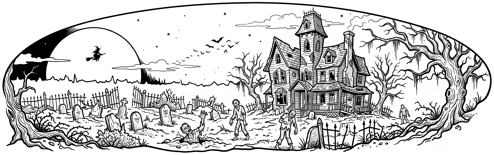

# 1:1 Woodburn Template Generator (Splitter)

A lightweight, browser-based utility that converts artwork and line drawings of any size into true-to-scale (1:1), multi-page printable PDFs. Specifically designed for **pyrography (wood burning)** and woodworking templates that span across multiple standard US Letter sheets.

**[Launch the Live Web App →](https://mlinnen.github.io/woodburn-template/app)**

## Features

- **Exact 1:1 Scaling:** Specify your desired total target width in inches (defaults to `17.0"`), and the tool automatically calculates the locked aspect-ratio height.
- **Automatic Multi-Page Grid Calculation:** Dynamically calculates the required number of columns and rows (`cols × rows`) on US Letter (`11" × 8.5"`) landscape pages based on your target dimensions, guaranteeing at least `0.75"` of margin/overlap around every seam (up to `9.5" × 7.0"` of active area per page).
- **Built-in Overlap & Red Dashed Alignment Guides:** Each page tile is centered on its sheet with overlapping artwork extending past the red dashed cut/alignment lines on all internal boundaries (left, right, top, and bottom), plus subtle page/grid labels (`Page X of Y (Row R, Col C)`) in the top-left corner.
- **Live Split Preview:** Displays your uploaded artwork (including mirrored state) with live red dashed lines showing exactly where the page splits will occur before generating the PDF.
- **Horizontal Mirroring:** One-click option to flip the image horizontally—essential when transferring patterns onto wood via **heat transfer** or **acetone toner transfer** methods.
- **Zero Installation / Client-Side Only:** Runs entirely in your browser from a single HTML file using [jsPDF](https://github.com/parallax/jsPDF) via CDN. No server or build step required.

## Project Structure

```text
├── .github/workflows/
│   └── deploy.yml                             # GitHub Actions build & Pages deployment
├── src/
│   └── template_printer.html                  # Main single-file web application source
└── samples/
    ├── Haunted_House_Wood_Burn.jpg            # Example panoramic wood-burning line art
    └── woodburn_template_17x5.37in.pdf        # Example 2-page PDF output (17" x 5.37")
```

### Sample Output
The [`samples/`](samples/) directory demonstrates a full workflow:
1. **Input Image ([`samples/Haunted_House_Wood_Burn.jpg`](samples/Haunted_House_Wood_Burn.jpg)):** A wide panoramic Halloween haunted house and graveyard illustration.
2. **Generated Template ([`samples/woodburn_template_17x5.37in.pdf`](samples/woodburn_template_17x5.37in.pdf)):** An example 2-page (`2 cols × 1 row`) landscape PDF scaled to **17.0" wide × 5.37" high**, complete with overlapping center sections and red dashed cut/alignment guides on both pages.



## How to Use

1. **Open the App:** Open the **[hosted GitHub Pages app](https://mlinnen.github.io/woodburn-template/app)** in your browser, or double-click [`src/template_printer.html`](src/template_printer.html) locally (an active internet connection is required to load the `jsPDF` library from CDN).
2. **Select Your Image:** Click **Choose File** under *1. Select Your Image* and upload your template image (`JPG`, `PNG`, `WEBP`, etc.).
3. **Set Target Width:** Enter your desired total physical width in inches under *2. Target Total Width (Inches)*.
   - **Calculated Height** updates automatically to preserve your artwork's original proportions.
   - **Calculated Page Layout** updates automatically to show the total number of pages and grid layout (e.g., `2 Pages (2 cols × 1 row)` or `6 Pages (3 cols × 2 rows)`), and the preview canvas updates with red dashed split lines.
4. **Configure Transfer Method (Optional):**
   - Leave **Mirror Image Horizontally** unchecked if you are using **graphite/carbon transfer paper** (tracing right-side up).
   - Check **Mirror Image Horizontally** if you are using a **heat tool / transfer tip** or **acetone toner transfer** (where the printed face goes down against the wood).
5. **Generate PDF:** Click the **Generate Landscape PDF** button. Your browser will download a file named `woodburn_template_<width>x<height>in_<cols>x<rows>pages.pdf` (with `_MIRRORED` appended if mirrored).

## Printing & Assembly Instructions

To ensure your printed template matches your exact target dimensions:

1. **Print at 100% Scale:** In your PDF viewer or printer dialog, make sure page scaling is set to **"Actual Size"** or **"Scale: 100%"** (do *not* use "Fit to Printable Area" or "Shrink to Fit").
2. **Check Grid Positions:** For multi-page templates, check the subtle label in the top-left corner of each sheet (`Page X of Y (Row R, Col C)`) to arrange your pages in order.
3. **Trim & Align Seams:** Along each internal boundary between adjacent pages, cut along the **red dashed line** on one sheet and align it directly over the matching **red dashed line** on the neighboring sheet. Use the overlapping artwork around the seam to verify perfect registration, then tape the sheets together before transferring to your wood blank.
